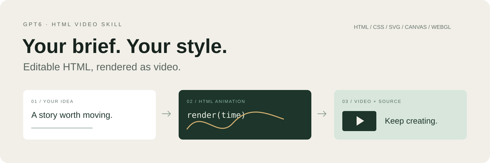
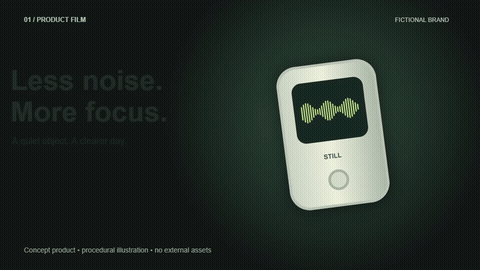
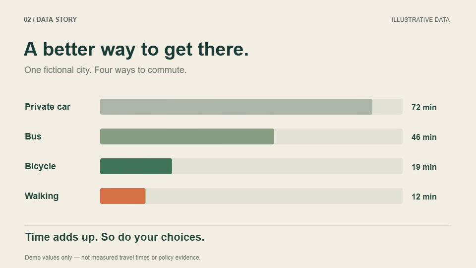
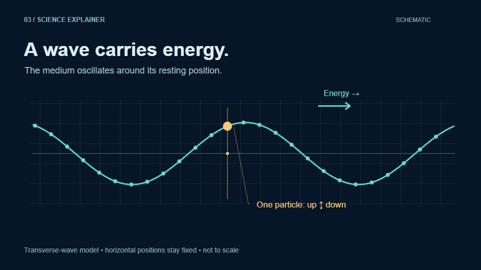
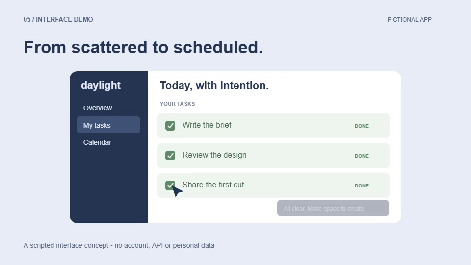

<p align="center"></p>

# GPT6 HTML Video Skill

### Make it move. Keep it editable.

Turn an idea, script, or reference into **HTML animation, then render it to video** with GPT-6 / Codex. Keep the source to refine the words, layout, motion, and timing.

**[Explore examples](examples/README.md) · [Get started](#get-started) · [中文](README.md) · [日本語](README.ja.md)**

## See it in motion

**Product concept · STILL**

An imagined focus device, brought to life through materials, gentle movement, and a changing waveform.

<a href="examples/previews/product.mp4"></a>

[Watch MP4](examples/previews/product.mp4) · [Read the code](examples/product/film.js) · [Run the examples](examples/README.md)

### Different content calls for different motion

<table>
<tr>
<td width="50%"><a href="examples/previews/data.mp4"></a><br><strong>Give data a story</strong><br>Staggered bars. Numbers that follow the motion.<br><a href="examples/previews/data.mp4">Watch</a> · <a href="examples/data/film.js">Source</a></td>
<td width="50%"><a href="examples/previews/science.mp4"></a><br><strong>Make a principle visible</strong><br>Track a moving wave and an oscillating particle.<br><a href="examples/previews/science.mp4">Watch</a> · <a href="examples/science/film.js">Source</a></td>
</tr>
<tr>
<td width="50%"><a href="examples/previews/typography.mp4"></a><br><strong>Let type set the rhythm</strong><br>Big lettering, masked reveals, a rotating accent.<br><a href="examples/previews/typography.mp4">Watch</a> · <a href="examples/typography/film.js">Source</a></td>
<td width="50%"><a href="examples/previews/interface.mp4"></a><br><strong>Show how a product works</strong><br>A cursor, changing states, and useful feedback.<br><a href="examples/previews/interface.mp4">Watch</a> · <a href="examples/interface/film.js">Source</a></td>
</tr>
</table>

Five original examples, each **8 seconds · 960×540 · 24 fps · silent**, with HTML, source, and rendering commands. Brands and data are fictional. These examples show possibilities; your brief sets the next direction.

## Start with your brief

Bring an idea, a script, assets, or brand guidelines. The content, style, duration, and way of working follow your request.

```text
Use $video-director to make a 20-second product introduction.
Follow the attached brand guidelines and demonstrate three key interactions.
Show me a preview first. Deliver MP4 and editable HTML source.
```

Slow the pace, move a label, rewrite a caption: describe the change and continue from the existing project. You can also bring an HTML animation you've already started.

| What you bring | What you can work on |
| --- | --- |
| An idea, script, or reference | Compose the visuals with HTML/CSS, SVG, Canvas, or WebGL |
| A first animation | Refine copy, layout, motion, timing, and assets |
| A project ready for delivery | Render video and inspect relevant frames and output specs |

Captions, narration, and music are optional. Assets and external services depend on the tools available in your environment.

## Get started

Ask the Codex skill installer to install:

```text
https://github.com/maeheelam-beep/gpt6-html-video-skill/tree/main/skills/video-director
```

Run `npm ci` in the **installed `video-director` directory**. Prepare **Node.js 20+, FFmpeg/FFprobe, and Chrome / Chromium / Edge**, then invoke `$video-director` with your brief.

<details>
<summary><strong>Run an example locally</strong></summary>

```bash
git clone https://github.com/maeheelam-beep/gpt6-html-video-skill.git
cd gpt6-html-video-skill
npm --prefix skills/video-director ci
node skills/video-director/runtime/backend.mjs preview examples
```

Open the URL printed in the terminal. GitHub file pages display source; they do not execute HTML. To render an example again:

```bash
node examples/render.mjs product
```

Set `CHROME_PATH` to your browser executable if discovery fails.

</details>

<details>
<summary><strong>Create, render, and check a project</strong></summary>

Adjust these example parameters to your project. The helper commands are optional; existing projects can keep their toolchain.

```bash
node skills/video-director/scripts/studio.mjs doctor
node skills/video-director/scripts/studio.mjs init my-film --duration 20 --size 1920x1080 --fps 24 --audio none
# Implement your content, then set starter=false in project.json.
node skills/video-director/scripts/studio.mjs render my-film --out film.mp4
node skills/video-director/scripts/studio.mjs qa my-film/film.mp4 --project my-film
node skills/video-director/scripts/studio.mjs review my-film
```

The bundled runtime supports one worker/sample, H.264 MP4, and mixing an existing audio file. Basic QA checks specs, frame count, audio presence, and full decoding; visual content still needs inspection. Advanced motion blur, black-frame detection, audio metering, and complex 3D require suitable tools. An installed, adapted `motion-showreel` is an optional backend.

</details>

## Go further

[Examples](examples/README.md) · [Skill instructions](skills/video-director/SKILL.md) · [Runtime](skills/video-director/references/runtime.md) · [Implementation options](skills/video-director/references/routes.md) · [Review tools](skills/video-director/references/review.md) · [Validation](docs/VALIDATION.md) · [Announcement copy](docs/ANNOUNCEMENTS.md)

Issues and new examples are welcome. Include the intended result, actual result, and reproduction steps when reporting a problem.

---

References and thanks: [Lemo-Opuscar](https://github.com/lemomo-ai/lemo-opuscar), [Garden Skills](https://github.com/ConardLi/garden-skills), and [AI Animation](https://github.com/Unclecheng-li/AI_Animation). Upstream media libraries are not bundled.

[MIT License](LICENSE) · [Third-party notices](THIRD_PARTY_NOTICES.md). Community project; not affiliated with or endorsed by OpenAI.
