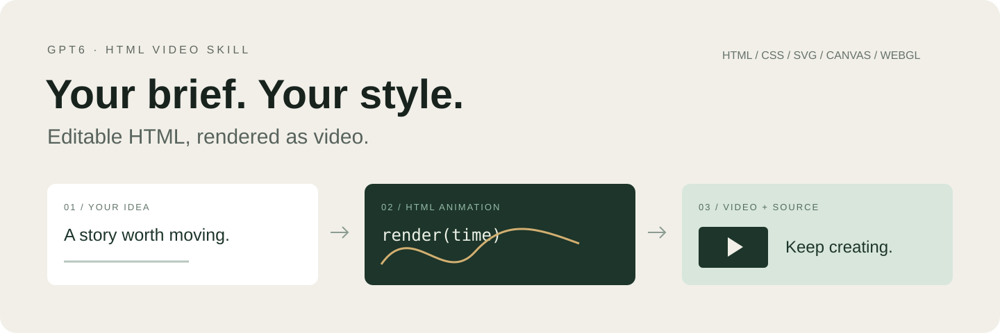
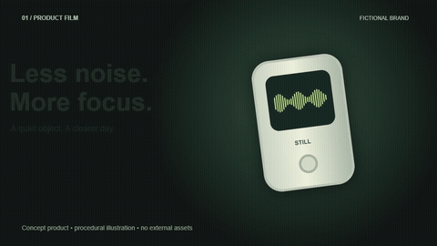
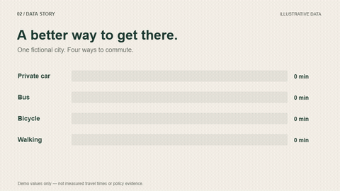
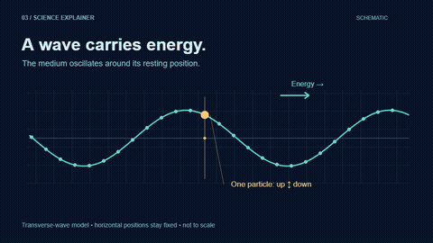
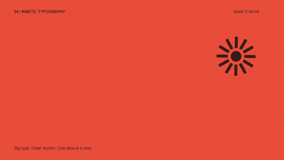
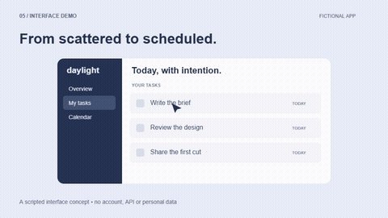

<p align="center"></p>

# GPT6 HTML Video Skill

### アイデアを、編集できるHTMLアニメーション動画へ。

GPT-6 / Codex向けの動画制作スキルです。アイデア、台本、参考デザイン、既存プロジェクトから、目的に合ったHTML/CSS・SVG・Canvas・WebGLを選んで実装し、ソースを残して動画に書き出します。

[中文](README.md) · [English](README.en.md) · [日本語](README.ja.md)

## 5つの目的、5つの表現

**8秒のMP4、実行できるHTML、編集可能なソース、再レンダリング用コマンド**を公開しています。[作例一覧](examples/README.md)へ。ブランドとデータは架空のデモです。次の作品の作風を固定するものではありません。

| 製品コンセプト | データストーリー |
| --- | --- |
| [](examples/product/) | [](examples/data/) |
| 科学の解説 | キネティック・タイポグラフィ |
| [](examples/science/) | [](examples/typography/) |
| UIデモ | |
| [](examples/interface/) | それぞれ異なる表現と、編集できるコード。 |

## 特長

- **要望から設計する。** 作風、尺、カット数、配色、音楽を固定しません。
- **ソースを編集できる。** 文言、レイアウト、動き、タイミング、素材を変更できます。
- **ブラウザーから動画へ。** 時刻を指定してフレームを取得し、FFmpegでエンコードします。
- **必要に応じて確認する。** 拡大可能な確認ページや、プロジェクト固有の検証を利用できます。
- **基本ランタイムを同梱。** すべての関連スキルをインストールする必要はありません。

## 依頼の例

```text
$video-director を使って、この商品紹介をHTMLアニメーション動画にしてください。
添付のブランドガイドに合わせ、操作体験を分かりやすく表現してください。
動画と編集可能なソースを納品してください。
```

詳しい仕様があっても、短いアイデアだけでも始められます。事前相談、プレビュー確認、字幕、ナレーション、音楽、出力形式は今回の要望に合わせます。

## インストール

Codexのスキルインストーラーに、次のディレクトリーのインストールを依頼します。

```text
https://github.com/maeheelam-beep/gpt6-html-video-skill/tree/main/skills/video-director
```

手動の場合は `skills/video-director` をユーザーのスキルディレクトリーにコピーしてください。補助コマンドを使う場合は、**インストール先のスキルディレクトリー**で `npm ci` を実行します。Node.js 20以上、FFmpeg/FFprobe、Chrome・Chromium・Edgeのいずれかが必要です。ブラウザーを検出できない場合は `CHROME_PATH` を設定します。

リポジトリーから直接使う場合：

```bash
git clone https://github.com/maeheelam-beep/gpt6-html-video-skill.git
cd gpt6-html-video-skill
npm --prefix skills/video-director ci
node skills/video-director/scripts/studio.mjs doctor
```

補助コマンドの例：

```bash
node skills/video-director/scripts/studio.mjs init my-film --duration 20 --size 1920x1080 --fps 24 --audio none
# 内容を実装し、project.json の starter を false に変更します。
node skills/video-director/scripts/studio.mjs render my-film --out film.mp4
node skills/video-director/scripts/studio.mjs qa my-film/film.mp4 --project my-film
node skills/video-director/scripts/studio.mjs review my-film
```

これは任意の補助ツールであり、創作手順の強制ではありません。既存の制作環境もそのまま利用できます。

## 対応範囲

同梱ランタイムは単一ワーカー・単一サンプルのレンダリング、H.264 MP4、既存音声の合成に対応します。基本検査は仕様、フレーム数、音声トラック、全編のデコードを確認します。高度なモーションブラーや音量測定などは追加ツールが必要です。動画生成モデル、TTS、キャラクター素材、複雑な3Dは実際に利用できる環境と権限に依存します。

[検証範囲](docs/VALIDATION.md) · [スキル本体](skills/video-director/SKILL.md) · [公開用紹介文](docs/ANNOUNCEMENTS.md)

[Lemo-Opuscar](https://github.com/lemomo-ai/lemo-opuscar)、[Garden Skills](https://github.com/ConardLi/garden-skills)、[AI Animation](https://github.com/Unclecheng-li/AI_Animation) の関連する機能や考え方を参考にしています。過去のユーザープロジェクトや上流の素材集は含みません。

[MIT License](LICENSE)。第三者の素材・依存ライブラリーには各ライセンスが適用されます。OpenAIの公式プロジェクトではありません。
