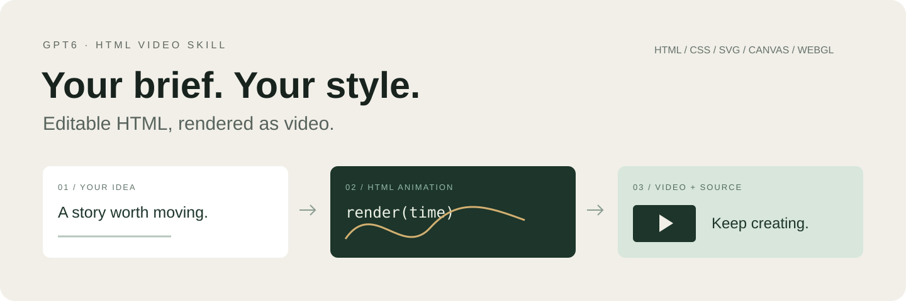

<p align="center"></p>

# GPT6 HTML Video Skill

### 把一句想法，变成可编辑的 HTML 动画视频。

**你的需求当导演，HTML 当片场。**

面向 GPT-6 / Codex 的动画视频技能：理解你的内容与参考，选择合适的 HTML/CSS、SVG、Canvas 或 WebGL 实现，保留源码，再导出视频。

[中文](README.md) · [English](README.en.md) · [日本語](README.ja.md)

## 一个入口，作品由你决定

产品介绍、动态排版、教学解释、数据可视化、界面动效……你决定要表达什么，它负责把需求落实到画面与可运行代码。

- **需求驱动**：不规定你的风格、时长、镜头数、配色或声音。
- **源码可编辑**：文字、布局、动作、时间和素材都能继续修改。
- **从预览到视频**：用可定位时间的 HTML 动画采集帧，交给 FFmpeg 编码。
- **按需验证**：生成可放大的检查页面；工具检测与实际视觉判断分别说明。
- **可独立起步**：附带基础渲染运行时；已有适配版 `motion-showreel` 时可复用其高级工具。

## 这样告诉它

```text
用 $video-director 把这份产品介绍做成 HTML 动画视频。
按附件里的品牌规范设计，重点突出交互体验，交付视频和可编辑源码。
```

也可以只说一个想法，或提供完整脚本与参考。要先讨论、先预览，还是直接完成，由你决定。字幕、配音、配乐和交付格式按本次需求选择。

## 安装与使用

### 在 Codex 中使用技能

让技能安装器安装本仓库中的 `skills/video-director`：

```text
安装 https://github.com/maeheelam-beep/gpt6-html-video-skill/tree/main/skills/video-director
```

或把该目录复制到你的用户技能目录。原生辅助命令需要在**已安装的技能目录**运行 `npm ci`，并准备 Node.js 20+、FFmpeg/FFprobe 和 Chrome、Chromium 或 Edge。

下一轮对话中，用 `$video-director` 加上你的需求开始。

### 直接使用仓库中的辅助命令

```bash
git clone https://github.com/maeheelam-beep/gpt6-html-video-skill.git
cd gpt6-html-video-skill
npm --prefix skills/video-director ci
node skills/video-director/scripts/studio.mjs doctor
```

找不到浏览器时，设置 `CHROME_PATH` 为本机浏览器可执行文件路径。基础运行时不需要另外安装所有上游技能。

```bash
# 技术起点：参数来自你的作品需求
node skills/video-director/scripts/studio.mjs init my-film --duration 20 --size 1920x1080 --fps 24 --audio none

# 实现自己的画面后，在 project.json 中设置 starter=false
node skills/video-director/scripts/studio.mjs render my-film --out film.mp4
node skills/video-director/scripts/studio.mjs qa my-film/film.mp4 --project my-film

# 可选：生成检查材料
node skills/video-director/scripts/studio.mjs review my-film
```

这些命令是可选工具，不是固定创作步骤。你也可以沿用已有 HTML 工程和渲染工具链。

## 你会得到什么

根据约定交付视频、可编辑 HTML 工程，以及需要的字幕、声音或说明。基础运行时支持单进程、单采样渲染、H.264 MP4 编码和已有音频混入；基础 QA 检查尺寸、帧率、时长、帧数、音轨与完整解码。黑帧检测、响度计量、复杂运动模糊等需要相应的高级工具。

角色素材、视频模型、TTS、复杂 3D 或其他外部服务按实际工具与授权接入。这个技能不训练模型、不切换账号设置，也不把提示词当成已经生成的影片。

## 文档

- [技能本体](skills/video-director/SKILL.md)
- [运行环境与规格](skills/video-director/references/runtime.md)
- [可选实现能力](skills/video-director/references/routes.md)
- [检查工具与边界](skills/video-director/references/review.md)
- [实际验证范围](docs/VALIDATION.md)
- [中英日发布文案](docs/ANNOUNCEMENTS.md)

## 致谢与许可

整合与参考了 [Lemo-Opuscar](https://github.com/lemomo-ai/lemo-opuscar)、[Garden Skills](https://github.com/ConardLi/garden-skills) 和 [AI Animation](https://github.com/Unclecheng-li/AI_Animation) 的相关能力与工作方法。按需使用，不携带历史用户项目，也不重新分发它们的完整素材库。

本仓库代码与文档采用 [MIT License](LICENSE)。第三方素材和依赖适用各自许可，见 [第三方说明](THIRD_PARTY_NOTICES.md)。本项目为社区项目，与 OpenAI 无隶属或背书关系。
