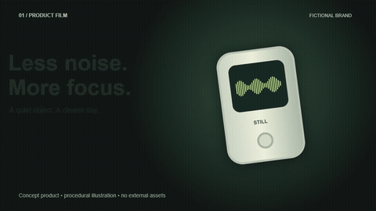
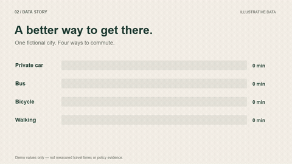
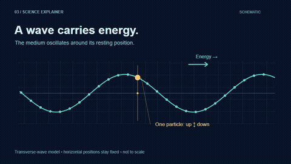
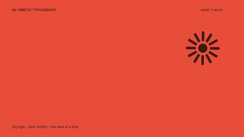
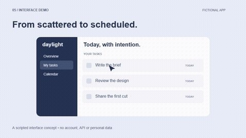

# Five briefs. Five visual languages.

五种内容，五种表达。以下均为原创、无外部素材的 **8 秒 / 960×540 / 24 fps / 无声**短示例，展示不同需求如何决定画面。它们是可编辑案例，不是技能要求所有用户照搬的模板。

Original, editable, silent demonstrations. These examples illustrate possibilities; they do not prescribe the next user's style or production process. / 異なる目的に合わせた、編集可能なオリジナル作例です。

## 01 · Product film / 产品概念片



**Brief:** Introduce a fictional focus device with restrained materials and calm motion. / 为虚构专注设备做一支克制、安静的产品短片。

深绿与暖白、程序绘制的设备、浮动姿态、动态屏幕波形。品牌 STILL 为本示例虚构。

[HTML source](product/index.html) · [Animation code](product/film.js) · [MP4](previews/product.mp4)

## 02 · Data story / 数据叙事



**Brief:** Compare four fictional commuting durations with an editorial chart. / 用编辑式图表逐项呈现四种虚构通勤时间。

纸色背景、错峰条形增长、同步数字与收束文案。**所有数值均为演示数据，不支持任何现实交通结论。**

[HTML source](data/index.html) · [Animation code](data/film.js) · [MP4](previews/data.mp4)

## 03 · Science explainer / 科学原理



**Brief:** Explain the distinction between wave propagation and particle oscillation. / 用横波示意区分波的传播与介质质点的振动。

质点横坐标保持不变，黄色质点上下振动，波形向右传播。此为理想化横波模型，不按真实比例绘制，也不是水面质点运动的完整模型。

[HTML source](science/index.html) · [Animation code](science/film.js) · [MP4](previews/science.mp4)

## 04 · Kinetic typography / 动态排版



**Brief:** Turn “MAKE ROOM FOR IDEAS” into a bold graphic statement. / 让一句创意宣言通过文字本身产生节奏。

珊瑚红、超大字、裁切揭示、旋转图形；不借助图表或产品插画。

[HTML source](typography/index.html) · [Animation code](typography/film.js) · [MP4](previews/typography.mp4)

## 05 · Interface demo / 软件界面演示



**Brief:** Show a fictional task app turning a busy list into a finished day. / 演示虚构任务应用中逐项完成工作的过程。

侧栏、状态变化、光标演出和完成提示均由代码绘制。daylight 为虚构界面，未连接真实账号或服务。

[HTML source](interface/index.html) · [Animation code](interface/film.js) · [MP4](previews/interface.mp4)

## Run / 运行 / 実行

从仓库根目录运行；Node.js 20+、FFmpeg/FFprobe、Chrome/Chromium/Edge 为外部依赖。

```sh
npm --prefix skills/video-director ci
node skills/video-director/runtime/backend.mjs preview examples
```

打开终端打印的本地地址，进入对应案例；HTML 会循环播放，可以暂停。请通过本地服务器打开，浏览器可能阻止 file:// 下的模块脚本。GitHub 文件页展示源码，不直接执行 HTML。

重新生成全部视频、静帧和 GIF：

```sh
node examples/render.mjs
# Or one example:
node examples/render.mjs science
```

每个子目录自包含 `index.html`、`film.js` 和 `project.json`。`film.js` 保留相同绘图工具和五个独立场景函数，`data-example` 选择当前场景；修改相应函数即可。所有动画通过 `window.render(t)` 定位时间，导出与播放采用同一绘制逻辑。`?render=1` 隐藏播放器按钮并停止自动推进，供逐帧渲染使用。

预览 GIF 为 480×270 / 10 fps，清晰度和流畅度请以 MP4 为准。本次视频通过规格、192 帧、无音轨和完整解码检查，并采样检查实际编码画面；这不代表所有浏览器、字体或任意后续修改均已验证。系统字体不同会造成字形差异。案例代码与绘图按仓库 MIT 许可提供。
